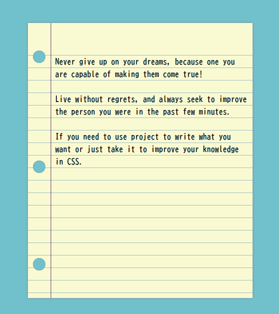
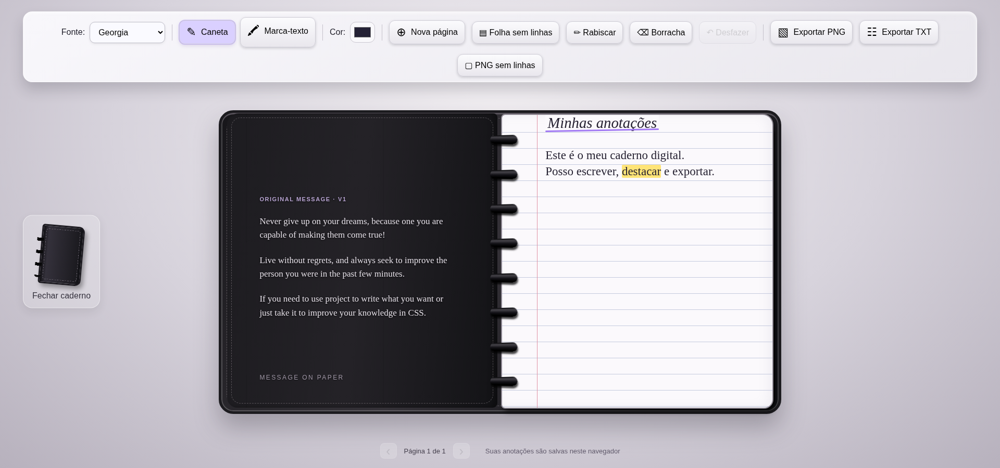
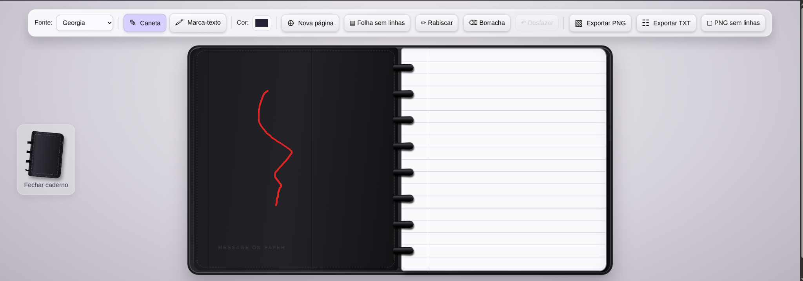

# Message-on-paper 📝

**From a single CSS paper sheet to an interactive digital notebook.**

Message-on-paper started as a small experiment: a sheet of lined paper created with HTML and CSS that anyone could type on. The current **V2.7** builds on that idea with a notebook interface, page management, handwriting tools, and exports. The original words have not been forgotten: they now live on the **inside left cover**, where you can read them whenever you open the notebook.

> **Project philosophy:** The interface has changed, but the message remains.

## Before and after

### V1 — The original paper



The original version used a single editable area on a yellow lined page with three punch holes, set against a light-blue background. The implementation was deliberately lightweight: **`index.html` and `style.css`**, with CSS creating the paper, lines, and holes. There was no multi-page notebook, drawing toolbar, local persistence, or dedicated export feature.

### V2.7 — The clean-code digital notebook (visual baseline from V2.6)



_Development-stage interface (V2.5):_



The new interface transforms the same idea into an interactive notebook with a dark cover, opening and page-turning animations, a ruled/blank page option, text tools, drawing tools, and image/text exports. The first screenshot shows the notebook after the V2.6 visual redesign with the original message restored. The second shows the redesigned interface immediately before that change.

## What changed?

| Area | V1 (original) | V2.7 (current) |
| --- | --- | --- |
| Design | Yellow paper on blue background | Dark notebook, opening cover, binding rings and page-turn animations |
| Writing | One `contenteditable` paper | Multiple editable pages with synchronized 31 px line spacing |
| Formatting | Basic browser text editing | Font choices, text color and selection-based highlighting |
| Sketching | Not available | Freehand drawing, large-area eraser, undo/redo for sketches |
| Page styles | Always ruled | Toggle ruled/blank paper per page |
| Export | No dedicated export | Current-page PNG, plain-page PNG and TXT |
| Persistence | No built-in notebook storage | Automatic browser `localStorage` saves |
| Architecture | HTML + CSS | HTML + CSS + modular JavaScript (MVC-style organization) |
| Run | Open HTML directly | Open HTML directly; no server or npm required |
| Original message | Written on the paper itself | Preserved verbatim on the inside left cover (desktop layout) |

## The original message lives on

These words are preserved **exactly as they appeared in V1**, including the original spelling:

> Never give up on your dreams, because one you are capable of making them come true!
>
> Live without regrets, and always seek to improve the person you were in the past few minutes.
>
> If you need to use project to write what you want or just take it to improve your knowledge in CSS.

On desktop, open the notebook to see the three paragraphs on the inside left cover. Their color has been brightened for better readability. The message is a fixed part of the notebook's design; it does not modify a user's notes or appear in exported pages.

## Features

- **Cover & navigation:** open/close the notebook, add pages, navigate between pages, and see page-turn animations.
- **Text editing:** write on ruled paper with consistent line spacing, change fonts and text color, and highlight selected text.
- **Freehand drawing:** use *Rabiscar* to sketch with a mouse or touch input.
- **Eraser:** use *Borracha* to erase drawing strokes with a roughly 76 px diameter brush without deleting typed text.
- **Undo/redo for sketches:** `Ctrl+Z` / `Cmd+Z` to undo, `Ctrl+Shift+Z` or `Ctrl+Y` to redo while a drawing tool is active. There is also an Undo button. The per-page drawing history stores up to 60 steps in the current session.
- **Paper appearance:** switch the current page between lined paper and a blank sheet.
- **Export:** save a PNG preserving the page appearance, export an unruled PNG, or download plain text as TXT. TXT does not preserve text colors or highlighting.
- **Autosave:** notes and sketches are stored in your browser on the current device with `localStorage`.

> **Note:** The notebook interface and original-message display are intended for desktop browsers. On narrow mobile layouts, the left inside cover is hidden to prioritize the editable page. Saved notes are local to the browser; clearing site storage may remove them.

## Getting started

1. Download this repository or clone it:

   ```bash
   git clone https://github.com/GustavoVitorS/Message-on-paper.git
   cd Message-on-paper
   ```

2. Open `index.html` in a modern desktop browser (Firefox, Brave, Chrome, or Chromium). The distributed script is compatible with opening the project using `file://`.

   Optionally, run a local web server:

   ```bash
   python3 -m http.server 8000
   ```

   Then visit `http://localhost:8000`.

3. Click the cover to open the notebook. Use the toolbar to write, highlight, sketch, erase, add pages, and export.

No external dependencies or backend are required. The project can also be hosted on GitHub Pages.

## Clean-code / MVC refactor (V2.7)

V2.7 is a **structural refactor** of V2.6, modeled on the separation used in larger MVC projects. It does not require PHP, Docker, Node.js, or a build step just to run the notebook.

- Styles are split into small, readable files according to their purpose. CSS rules are now vertically formatted, one declaration per line, with whitespace separating selector blocks.
- JavaScript source is separated into **model**, **view**, **controller**, **services**, and **utilities**. `build.py` assembles a classic, offline-compatible browser script.
- `app.offline.js` is an **auto-generated distribution artifact**. Do not edit it directly; modify the original JavaScript modules and rerun `python3 build.py`.
- **Cascade order matters:** stylesheets in `index.html` are intentionally linked in sequence, including the editor line-spacing overrides that fixed Enter alignment.
- The project retains the original V1 message and all before/after screenshots.

## Project structure

```text
Message-on-paper/
├── index.html
├── README.md
├── build.py
├── assets/
│   ├── css/
│   │   ├── base.css
│   │   ├── toolbar.css
│   │   ├── workspace.css
│   │   ├── notebook.css
│   │   ├── feedback.css
│   │   ├── responsive.css
│   │   ├── paper-tools.css
│   │   ├── editor.css
│   │   └── legacy-cover.css
│   └── js/
│       ├── main.js
│       ├── app.offline.js             # Generated classic bundle
│       ├── models/Notebook.js
│       ├── views/NotebookView.js
│       ├── controllers/NotebookController.js
│       ├── services/
│       │   ├── StorageService.js
│       │   └── ExportService.js
│       └── utils/sanitize.js
└── docs/
    └── screenshots/
        ├── v1-original.png
        ├── v2-notebook.png
        └── v2-6-open-with-original-message.png
```

The source code follows an **MVC-style separation**: models hold notebook data, the view manages rendering, controllers handle interactions, and services handle storage and downloads.

### Changing the JavaScript

`index.html` loads the generated classic `assets/js/app.offline.js` so that the site can be opened directly from the file system. If you change any source module in `assets/js/`, rebuild the bundle using:

```bash
python3 build.py
```

Commit the generated bundle along with the source changes. Python is only needed for rebuilding, not for using the site.

## Version journey

- **V1:** Minimal editable paper using HTML and CSS.
- **V2.0–V2.1:** Notebook redesign and offline-friendly JavaScript distribution.
- **V2.2:** Drawing, highlighter, blank paper, and plain PNG exports.
- **V2.3:** Text/Enter line alignment and ruled-paper scrolling fixes.
- **V2.4:** Eraser added for freehand marks.
- **V2.5:** Larger eraser, drawing undo/redo, and a toolbar Undo button.
- **V2.6:** English project documentation, before/after screenshots, and the original V1 message restored on the inside cover with better contrast.
- **V2.7:** Readable CSS modules, improved code layout, and an organized MVC source tree. No feature removal.

## Publishing on GitHub Pages

Go to **Settings → Pages** in the repository. Under **Build and deployment**, select **Deploy from a branch**, choose `master` and `/(root)`, then save. `index.html` is the entry point and needs no build during deployment.

## Credits

Created by [GustavoVitorS](https://github.com/GustavoVitorS). The project evolves the original **Message-on-paper** experiment while preserving its message.

## License

No new license file has been added. Consult the repository for its licensing status before reuse or redistribution.
